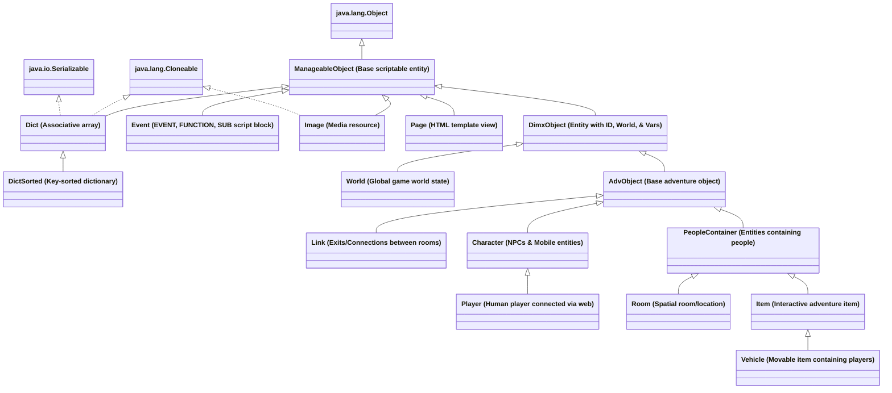
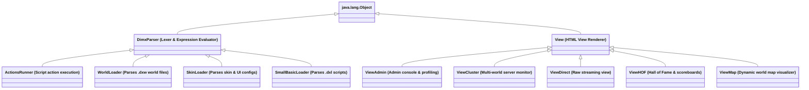
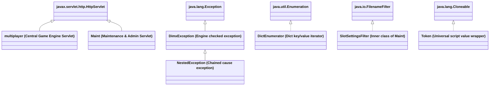
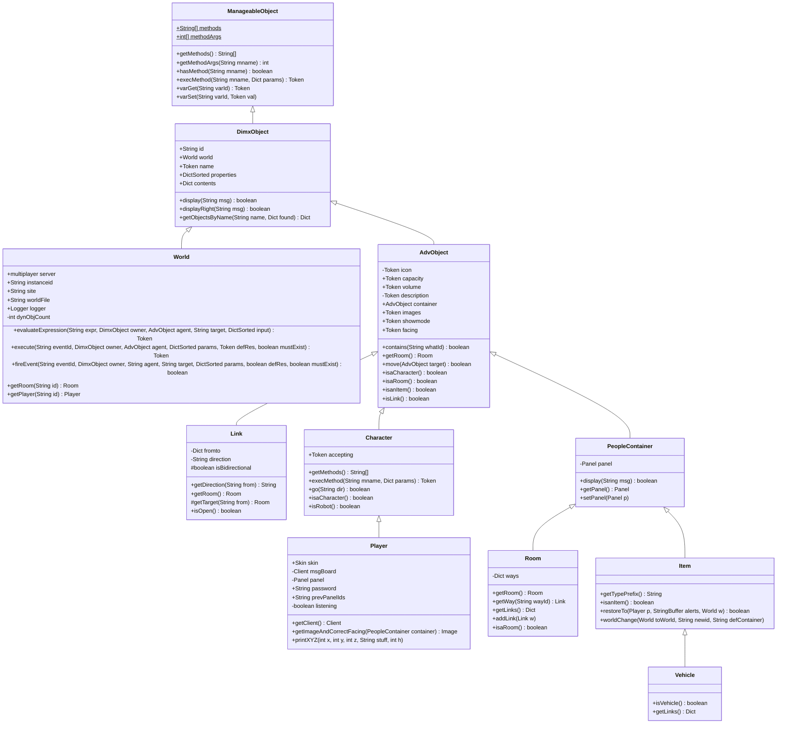
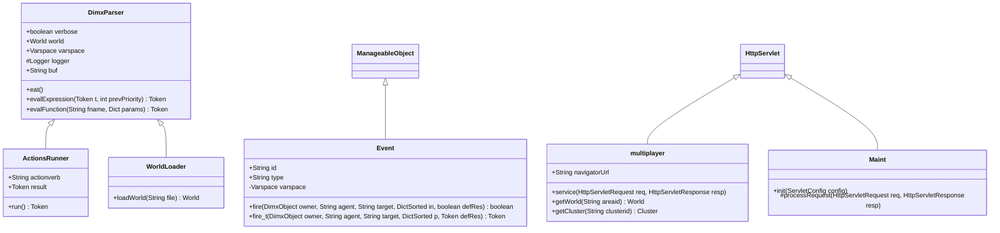

# Class Hierarchy of DimensioneX (`cleoni.adv`)

> [!NOTE]
> **Project Summary**: The attached codebase is **DimensioneX** (DimX, version 7.1.8), a Java-based multiplayer virtual world and interactive adventure game engine developed by Cristiano Leoni. All source files reside in the package `cleoni.adv` within [WEB-INF/classes/cleoni/adv](file:///c:/Users/gluci/Documents/Antigravity/Dimy/WEB-INF/classes/cleoni/adv). There are **46 classes** across **45 source files**.

---

## 1. High-Level Class Hierarchy Diagrams

### Core Game Domain Hierarchy (`ManageableObject`)
The core domain hierarchy forms the foundation of DimensioneX's entity and data modeling. Every scriptable entity, data collection, and game object inherits from [`ManageableObject`](file:///c:/Users/gluci/Documents/Antigravity/Dimy/WEB-INF/classes/cleoni/adv/ManageableObject.java#L12), which provides a dynamic method dispatch table (`getMethods()`, `execMethod()`) and property evaluation system for DimX SmallBasic scripting.

---

### Parser, Scripting & View Subsystems

---

### Web Servlets, Exceptions & Utility Components

---

## 2. Complete Class Catalog

All classes belong to package `cleoni.adv`.

| Class | Superclass | Implemented Interfaces | Source File | Description / Architectural Role |
| :--- | :--- | :--- | :--- | :--- |
| [`ActionsRunner`](file:///c:/Users/gluci/Documents/Antigravity/Dimy/WEB-INF/classes/cleoni/adv/ActionsRunner.java#L12) | [`DimxParser`](file:///c:/Users/gluci/Documents/Antigravity/Dimy/WEB-INF/classes/cleoni/adv/DimxParser.java#L10) | — | [ActionsRunner.java](file:///c:/Users/gluci/Documents/Antigravity/Dimy/WEB-INF/classes/cleoni/adv/ActionsRunner.java) | Evaluates and executes game event actions and SmallBasic script statements during gameplay. |
| [`AdvObject`](file:///c:/Users/gluci/Documents/Antigravity/Dimy/WEB-INF/classes/cleoni/adv/AdvObject.java#L10) | [`DimxObject`](file:///c:/Users/gluci/Documents/Antigravity/Dimy/WEB-INF/classes/cleoni/adv/DimxObject.java#L11) | — | [AdvObject.java](file:///c:/Users/gluci/Documents/Antigravity/Dimy/WEB-INF/classes/cleoni/adv/AdvObject.java) | Base class for in-world adventure entities (`Character`, `Item`, `Link`, `Room`), holding positions, images, containers, and visibility. |
| [`Character`](file:///c:/Users/gluci/Documents/Antigravity/Dimy/WEB-INF/classes/cleoni/adv/Character.java#L4) | [`AdvObject`](file:///c:/Users/gluci/Documents/Antigravity/Dimy/WEB-INF/classes/cleoni/adv/AdvObject.java#L10) | — | [Character.java](file:///c:/Users/gluci/Documents/Antigravity/Dimy/WEB-INF/classes/cleoni/adv/Character.java) | Animated non-player or actor entity capable of directional navigation (`go`), talking, carrying items, and responding to events. |
| [`Client`](file:///c:/Users/gluci/Documents/Antigravity/Dimy/WEB-INF/classes/cleoni/adv/Client.java#L6) | `Object` | — | [Client.java](file:///c:/Users/gluci/Documents/Antigravity/Dimy/WEB-INF/classes/cleoni/adv/Client.java) | Tracks user client browser session, display dimensions, scale factors (`factorx`, `factory`), sound support, and pending command queue. |
| [`Cluster`](file:///c:/Users/gluci/Documents/Antigravity/Dimy/WEB-INF/classes/cleoni/adv/Cluster.java#L15) | `Object` | — | [Cluster.java](file:///c:/Users/gluci/Documents/Antigravity/Dimy/WEB-INF/classes/cleoni/adv/Cluster.java) | Coordinates multi-world game server instances, SQL database connectivity, journal logging, and cross-world management. |
| [`Const`](file:///c:/Users/gluci/Documents/Antigravity/Dimy/WEB-INF/classes/cleoni/adv/Const.java#L4) | `Object` | — | [Const.java](file:///c:/Users/gluci/Documents/Antigravity/Dimy/WEB-INF/classes/cleoni/adv/Const.java) | Central constants dictionary defining command verbs, screen modes, directions (N, S, E, W, etc.), and type tags. |
| [`Ctrl`](file:///c:/Users/gluci/Documents/Antigravity/Dimy/WEB-INF/classes/cleoni/adv/Ctrl.java#L8) | `Object` | — | [Ctrl.java](file:///c:/Users/gluci/Documents/Antigravity/Dimy/WEB-INF/classes/cleoni/adv/Ctrl.java) | Individual interactive browser UI control (buttons, links, text inputs, ghost buttons) inside UI panels. |
| [`Dict`](file:///c:/Users/gluci/Documents/Antigravity/Dimy/WEB-INF/classes/cleoni/adv/Dict.java#L9) | [`ManageableObject`](file:///c:/Users/gluci/Documents/Antigravity/Dimy/WEB-INF/classes/cleoni/adv/ManageableObject.java#L12) | `Cloneable`, `Serializable` | [Dict.java](file:///c:/Users/gluci/Documents/Antigravity/Dimy/WEB-INF/classes/cleoni/adv/Dict.java) | Dynamic associative array implementation modeled after VBScript Dictionary/Vector, used for properties and collections throughout DimX. |
| [`DictEnumerator`](file:///c:/Users/gluci/Documents/Antigravity/Dimy/WEB-INF/classes/cleoni/adv/DictEnumerator.java#L7) | `Object` | `java.util.Enumeration` | [DictEnumerator.java](file:///c:/Users/gluci/Documents/Antigravity/Dimy/WEB-INF/classes/cleoni/adv/DictEnumerator.java) | Iterator for traversing elements within a `Dict`. |
| [`DictSorted`](file:///c:/Users/gluci/Documents/Antigravity/Dimy/WEB-INF/classes/cleoni/adv/DictSorted.java#L15) | [`Dict`](file:///c:/Users/gluci/Documents/Antigravity/Dimy/WEB-INF/classes/cleoni/adv/Dict.java#L9) | — | [DictSorted.java](file:///c:/Users/gluci/Documents/Antigravity/Dimy/WEB-INF/classes/cleoni/adv/DictSorted.java) | Specialization of `Dict` that maintains keys in sorted order for fast lookup and sorted enumerations. |
| [`DimxException`](file:///c:/Users/gluci/Documents/Antigravity/Dimy/WEB-INF/classes/cleoni/adv/DimxException.java#L6) | `java.lang.Exception` | — | [DimxException.java](file:///c:/Users/gluci/Documents/Antigravity/Dimy/WEB-INF/classes/cleoni/adv/DimxException.java) | Base engine checked exception for parsing errors, runtime script failures, and illegal state exceptions. |
| [`DimxObject`](file:///c:/Users/gluci/Documents/Antigravity/Dimy/WEB-INF/classes/cleoni/adv/DimxObject.java#L11) | [`ManageableObject`](file:///c:/Users/gluci/Documents/Antigravity/Dimy/WEB-INF/classes/cleoni/adv/ManageableObject.java#L12) | — | [DimxObject.java](file:///c:/Users/gluci/Documents/Antigravity/Dimy/WEB-INF/classes/cleoni/adv/DimxObject.java) | Common base for high-level DimensioneX objects (`World` and `AdvObject`), maintaining unique `id`, `name`, `properties`, and `contents`. |
| [`DimxParser`](file:///c:/Users/gluci/Documents/Antigravity/Dimy/WEB-INF/classes/cleoni/adv/DimxParser.java#L10) | `Object` | — | [DimxParser.java](file:///c:/Users/gluci/Documents/Antigravity/Dimy/WEB-INF/classes/cleoni/adv/DimxParser.java) | Core tokenizer, expression evaluator, arithmetic/logical evaluator, and built-in SmallBasic function registry. |
| [`Event`](file:///c:/Users/gluci/Documents/Antigravity/Dimy/WEB-INF/classes/cleoni/adv/Event.java#L6) | [`ManageableObject`](file:///c:/Users/gluci/Documents/Antigravity/Dimy/WEB-INF/classes/cleoni/adv/ManageableObject.java#L12) | — | [Event.java](file:///c:/Users/gluci/Documents/Antigravity/Dimy/WEB-INF/classes/cleoni/adv/Event.java) | Encapsulates script execution units (`EVENT`, `FUNCTION`, `SUB`) with formal parameters, local `Varspace`, and script body. |
| [`Image`](file:///c:/Users/gluci/Documents/Antigravity/Dimy/WEB-INF/classes/cleoni/adv/Image.java#L4) | [`ManageableObject`](file:///c:/Users/gluci/Documents/Antigravity/Dimy/WEB-INF/classes/cleoni/adv/ManageableObject.java#L12) | `Cloneable` | [Image.java](file:///c:/Users/gluci/Documents/Antigravity/Dimy/WEB-INF/classes/cleoni/adv/Image.java) | Media descriptor holding URLs, dimension metadata (width, height, baseline), and HTML rendering tags. |
| [`Item`](file:///c:/Users/gluci/Documents/Antigravity/Dimy/WEB-INF/classes/cleoni/adv/Item.java#L4) | [`PeopleContainer`](file:///c:/Users/gluci/Documents/Antigravity/Dimy/WEB-INF/classes/cleoni/adv/PeopleContainer.java#L12) | — | [Item.java](file:///c:/Users/gluci/Documents/Antigravity/Dimy/WEB-INF/classes/cleoni/adv/Item.java) | Interactive game item capable of being taken, dropped, worn, inspected, and containing other items or characters. |
| [`Journal`](file:///c:/Users/gluci/Documents/Antigravity/Dimy/WEB-INF/classes/cleoni/adv/Journal.java#L10) | `Object` | — | [Journal.java](file:///c:/Users/gluci/Documents/Antigravity/Dimy/WEB-INF/classes/cleoni/adv/Journal.java) | File-based action journaling system for event replay, player command audit logs, and game session logging. |
| [`Link`](file:///c:/Users/gluci/Documents/Antigravity/Dimy/WEB-INF/classes/cleoni/adv/Link.java#L4) | [`AdvObject`](file:///c:/Users/gluci/Documents/Antigravity/Dimy/WEB-INF/classes/cleoni/adv/AdvObject.java#L10) | — | [Link.java](file:///c:/Users/gluci/Documents/Antigravity/Dimy/WEB-INF/classes/cleoni/adv/Link.java) | Represents directional connections/ways between rooms with bidirectional routing, direction names, and open/locked status. |
| [`Logger`](file:///c:/Users/gluci/Documents/Antigravity/Dimy/WEB-INF/classes/cleoni/adv/Logger.java#L10) | `Object` | — | [Logger.java](file:///c:/Users/gluci/Documents/Antigravity/Dimy/WEB-INF/classes/cleoni/adv/Logger.java) | Logging utility providing categorized console and disk logging (debug, warning, info, error). |
| [`Maint`](file:///c:/Users/gluci/Documents/Antigravity/Dimy/WEB-INF/classes/cleoni/adv/Maint.java#L21) | `javax.servlet.http.HttpServlet` | — | [Maint.java](file:///c:/Users/gluci/Documents/Antigravity/Dimy/WEB-INF/classes/cleoni/adv/Maint.java) | Administration and maintenance HTTP servlet for user profile management, world backup, and server health. |
| [`SlotSettingsFilter`](file:///c:/Users/gluci/Documents/Antigravity/Dimy/WEB-INF/classes/cleoni/adv/Maint.java#L452) | `Object` | `java.io.FilenameFilter` | [Maint.java](file:///c:/Users/gluci/Documents/Antigravity/Dimy/WEB-INF/classes/cleoni/adv/Maint.java#L452) | Inner filter class within `Maint` that discovers world properties and slot configuration files on disk. |
| [`ManageableObject`](file:///c:/Users/gluci/Documents/Antigravity/Dimy/WEB-INF/classes/cleoni/adv/ManageableObject.java#L12) | `Object` | — | [ManageableObject.java](file:///c:/Users/gluci/Documents/Antigravity/Dimy/WEB-INF/classes/cleoni/adv/ManageableObject.java) | Root scriptable base class providing method dispatch tables, reflection-free script invocation, and property lookup. |
| [`Message`](file:///c:/Users/gluci/Documents/Antigravity/Dimy/WEB-INF/classes/cleoni/adv/Message.java#L11) | `Object` | — | [Message.java](file:///c:/Users/gluci/Documents/Antigravity/Dimy/WEB-INF/classes/cleoni/adv/Message.java) | Chat, notification, or private message entity passed between players or broadcast by the engine. |
| [`Messages`](file:///c:/Users/gluci/Documents/Antigravity/Dimy/WEB-INF/classes/cleoni/adv/Messages.java#L7) | `Object` | — | [Messages.java](file:///c:/Users/gluci/Documents/Antigravity/Dimy/WEB-INF/classes/cleoni/adv/Messages.java) | Multi-language localization manager loading localized strings and game system text from `.properties` files. |
| [`multiplayer`](file:///c:/Users/gluci/Documents/Antigravity/Dimy/WEB-INF/classes/cleoni/adv/multiplayer.java#L242) | `javax.servlet.http.HttpServlet` | — | [multiplayer.java](file:///c:/Users/gluci/Documents/Antigravity/Dimy/WEB-INF/classes/cleoni/adv/multiplayer.java) | Main entry-point game engine servlet handling HTTP request loop, world ticking, player sessions, and rendering HTML frames. |
| [`NestedException`](file:///c:/Users/gluci/Documents/Antigravity/Dimy/WEB-INF/classes/cleoni/adv/NestedException.java#L7) | [`DimxException`](file:///c:/Users/gluci/Documents/Antigravity/Dimy/WEB-INF/classes/cleoni/adv/DimxException.java#L6) | — | [NestedException.java](file:///c:/Users/gluci/Documents/Antigravity/Dimy/WEB-INF/classes/cleoni/adv/NestedException.java) | Exception chaining wrapper preserving root cause exceptions across script and parser execution boundaries. |
| [`Page`](file:///c:/Users/gluci/Documents/Antigravity/Dimy/WEB-INF/classes/cleoni/adv/Page.java#L13) | [`ManageableObject`](file:///c:/Users/gluci/Documents/Antigravity/Dimy/WEB-INF/classes/cleoni/adv/ManageableObject.java#L12) | — | [Page.java](file:///c:/Users/gluci/Documents/Antigravity/Dimy/WEB-INF/classes/cleoni/adv/Page.java) | HTML template page entity that performs macro replacements and generates HTML responses. |
| [`Panel`](file:///c:/Users/gluci/Documents/Antigravity/Dimy/WEB-INF/classes/cleoni/adv/Panel.java#L6) | `Object` | — | [Panel.java](file:///c:/Users/gluci/Documents/Antigravity/Dimy/WEB-INF/classes/cleoni/adv/Panel.java) | UI control container representing interactive button panels, compass navigation, and command bars. |
| [`PeopleContainer`](file:///c:/Users/gluci/Documents/Antigravity/Dimy/WEB-INF/classes/cleoni/adv/PeopleContainer.java#L12) | [`AdvObject`](file:///c:/Users/gluci/Documents/Antigravity/Dimy/WEB-INF/classes/cleoni/adv/AdvObject.java#L10) | — | [PeopleContainer.java](file:///c:/Users/gluci/Documents/Antigravity/Dimy/WEB-INF/classes/cleoni/adv/PeopleContainer.java) | Specialized base class for spatial entities capable of containing humans and characters (`Room`, `Item`/`Vehicle`). |
| [`Player`](file:///c:/Users/gluci/Documents/Antigravity/Dimy/WEB-INF/classes/cleoni/adv/Player.java#L6) | [`Character`](file:///c:/Users/gluci/Documents/Antigravity/Dimy/WEB-INF/classes/cleoni/adv/Character.java#L4) | — | [Player.java](file:///c:/Users/gluci/Documents/Antigravity/Dimy/WEB-INF/classes/cleoni/adv/Player.java) | Human-controlled character connected to a live web session, containing inventory, skin preferences, client state, and score. |
| [`Room`](file:///c:/Users/gluci/Documents/Antigravity/Dimy/WEB-INF/classes/cleoni/adv/Room.java#L7) | [`PeopleContainer`](file:///c:/Users/gluci/Documents/Antigravity/Dimy/WEB-INF/classes/cleoni/adv/PeopleContainer.java#L12) | — | [Room.java](file:///c:/Users/gluci/Documents/Antigravity/Dimy/WEB-INF/classes/cleoni/adv/Room.java) | Discrete virtual location in the world containing background images, exit links (`ways`), items, and characters. |
| [`Skin`](file:///c:/Users/gluci/Documents/Antigravity/Dimy/WEB-INF/classes/cleoni/adv/Skin.java#L4) | `Object` | — | [Skin.java](file:///c:/Users/gluci/Documents/Antigravity/Dimy/WEB-INF/classes/cleoni/adv/Skin.java) | Visual theme definition configuring background colors, fonts, panel layouts, icons, and CSS styles. |
| [`SkinLoader`](file:///c:/Users/gluci/Documents/Antigravity/Dimy/WEB-INF/classes/cleoni/adv/SkinLoader.java#L12) | [`DimxParser`](file:///c:/Users/gluci/Documents/Antigravity/Dimy/WEB-INF/classes/cleoni/adv/DimxParser.java#L10) | — | [SkinLoader.java](file:///c:/Users/gluci/Documents/Antigravity/Dimy/WEB-INF/classes/cleoni/adv/SkinLoader.java) | Specialized parser for loading skin and client theme definition scripts. |
| [`SmallBasicLoader`](file:///c:/Users/gluci/Documents/Antigravity/Dimy/WEB-INF/classes/cleoni/adv/SmallBasicLoader.java#L14) | [`DimxParser`](file:///c:/Users/gluci/Documents/Antigravity/Dimy/WEB-INF/classes/cleoni/adv/DimxParser.java#L10) | — | [SmallBasicLoader.java](file:///c:/Users/gluci/Documents/Antigravity/Dimy/WEB-INF/classes/cleoni/adv/SmallBasicLoader.java) | Parses DimensioneX SmallBasic script source code libraries (`.dxl`) into executable `Event` objects. |
| [`Token`](file:///c:/Users/gluci/Documents/Antigravity/Dimy/WEB-INF/classes/cleoni/adv/Token.java#L7) | `Object` | `Cloneable` | [Token.java](file:///c:/Users/gluci/Documents/Antigravity/Dimy/WEB-INF/classes/cleoni/adv/Token.java) | Polymorphic dynamically typed value container (String, Number, DimxObject, Dict, Boolean) used by the script interpreter. |
| [`Utils`](file:///c:/Users/gluci/Documents/Antigravity/Dimy/WEB-INF/classes/cleoni/adv/Utils.java#L18) | `Object` | — | [Utils.java](file:///c:/Users/gluci/Documents/Antigravity/Dimy/WEB-INF/classes/cleoni/adv/Utils.java) | Static utility toolkit for string manipulation, date formatting, HTML escaping, math, and HTTP header helpers. |
| [`Varspace`](file:///c:/Users/gluci/Documents/Antigravity/Dimy/WEB-INF/classes/cleoni/adv/Varspace.java#L7) | `Object` | — | [Varspace.java](file:///c:/Users/gluci/Documents/Antigravity/Dimy/WEB-INF/classes/cleoni/adv/Varspace.java) | Symbol table and variable storage environment for script scopes, local function arguments, and global world variables. |
| [`Vehicle`](file:///c:/Users/gluci/Documents/Antigravity/Dimy/WEB-INF/classes/cleoni/adv/Vehicle.java#L12) | [`Item`](file:///c:/Users/gluci/Documents/Antigravity/Dimy/WEB-INF/classes/cleoni/adv/Item.java#L4) | — | [Vehicle.java](file:///c:/Users/gluci/Documents/Antigravity/Dimy/WEB-INF/classes/cleoni/adv/Vehicle.java) | Movable item that can transport passengers across links and rooms, acting both as an item and as a passenger container. |
| [`View`](file:///c:/Users/gluci/Documents/Antigravity/Dimy/WEB-INF/classes/cleoni/adv/View.java#L19) | `Object` | — | [View.java](file:///c:/Users/gluci/Documents/Antigravity/Dimy/WEB-INF/classes/cleoni/adv/View.java) | Base HTML view generator producing web client components, scene backgrounds, multimedia embeds, and chat frames. |
| [`ViewAdmin`](file:///c:/Users/gluci/Documents/Antigravity/Dimy/WEB-INF/classes/cleoni/adv/ViewAdmin.java#L13) | [`View`](file:///c:/Users/gluci/Documents/Antigravity/Dimy/WEB-INF/classes/cleoni/adv/View.java#L19) | — | [ViewAdmin.java](file:///c:/Users/gluci/Documents/Antigravity/Dimy/WEB-INF/classes/cleoni/adv/ViewAdmin.java) | Admin console view rendering CPU performance stats, script optimizer telemetry, and active world details. |
| [`ViewCluster`](file:///c:/Users/gluci/Documents/Antigravity/Dimy/WEB-INF/classes/cleoni/adv/ViewCluster.java#L19) | [`View`](file:///c:/Users/gluci/Documents/Antigravity/Dimy/WEB-INF/classes/cleoni/adv/View.java#L19) | — | [ViewCluster.java](file:///c:/Users/gluci/Documents/Antigravity/Dimy/WEB-INF/classes/cleoni/adv/ViewCluster.java) | Cluster view displaying status of distributed world nodes, connected databases, and server health. |
| [`ViewDirect`](file:///c:/Users/gluci/Documents/Antigravity/Dimy/WEB-INF/classes/cleoni/adv/ViewDirect.java#L19) | [`View`](file:///c:/Users/gluci/Documents/Antigravity/Dimy/WEB-INF/classes/cleoni/adv/View.java#L19) | — | [ViewDirect.java](file:///c:/Users/gluci/Documents/Antigravity/Dimy/WEB-INF/classes/cleoni/adv/ViewDirect.java) | Passthrough view rendering unadorned direct output to the client. |
| [`ViewHOF`](file:///c:/Users/gluci/Documents/Antigravity/Dimy/WEB-INF/classes/cleoni/adv/ViewHOF.java#L14) | [`View`](file:///c:/Users/gluci/Documents/Antigravity/Dimy/WEB-INF/classes/cleoni/adv/View.java#L19) | — | [ViewHOF.java](file:///c:/Users/gluci/Documents/Antigravity/Dimy/WEB-INF/classes/cleoni/adv/ViewHOF.java) | Hall of Fame view rendering top player leaderboards, high scores, and persistent records. |
| [`ViewMap`](file:///c:/Users/gluci/Documents/Antigravity/Dimy/WEB-INF/classes/cleoni/adv/ViewMap.java#L12) | [`View`](file:///c:/Users/gluci/Documents/Antigravity/Dimy/WEB-INF/classes/cleoni/adv/View.java#L19) | — | [ViewMap.java](file:///c:/Users/gluci/Documents/Antigravity/Dimy/WEB-INF/classes/cleoni/adv/ViewMap.java) | Map view rendering graphical or 2D grid representations of discovered rooms and connections. |
| [`World`](file:///c:/Users/gluci/Documents/Antigravity/Dimy/WEB-INF/classes/cleoni/adv/World.java#L6) | [`DimxObject`](file:///c:/Users/gluci/Documents/Antigravity/Dimy/WEB-INF/classes/cleoni/adv/DimxObject.java#L11) | — | [World.java](file:///c:/Users/gluci/Documents/Antigravity/Dimy/WEB-INF/classes/cleoni/adv/World.java) | The central game environment singleton/aggregate holding all rooms, items, links, active players, global clock ticks, and scripts. |
| [`WorldLoader`](file:///c:/Users/gluci/Documents/Antigravity/Dimy/WEB-INF/classes/cleoni/adv/WorldLoader.java#L13) | [`DimxParser`](file:///c:/Users/gluci/Documents/Antigravity/Dimy/WEB-INF/classes/cleoni/adv/DimxParser.java#L10) | — | [WorldLoader.java](file:///c:/Users/gluci/Documents/Antigravity/Dimy/WEB-INF/classes/cleoni/adv/WorldLoader.java) | Parser and compiler for `.dxw` world definition files, constructing the full in-memory `World` graph. |

---

## 3. Subsystem Breakdown & Architecture Patterns

### A. The Dynamic Entity & Scripting Model
- **Reflective dispatch without overhead**: DimensioneX targets high throughput inside Java servlets while interpreting scripts dynamically. Rather than heavy reflection, [`ManageableObject`](file:///c:/Users/gluci/Documents/Antigravity/Dimy/WEB-INF/classes/cleoni/adv/ManageableObject.java#L12) defines static `methods` and `methodArgs` arrays that subclasses override (`getMethods()`, `execMethod()`).
- **Dynamic Typing**: [`Token`](file:///c:/Users/gluci/Documents/Antigravity/Dimy/WEB-INF/classes/cleoni/adv/Token.java#L7) encapsulates strings, doubles, booleans, references, and sets, enabling SmallBasic scripts to interact with Java game objects seamlessly.
- **Associative Data Structures**: [`Dict`](file:///c:/Users/gluci/Documents/Antigravity/Dimy/WEB-INF/classes/cleoni/adv/Dict.java#L9) and [`DictSorted`](file:///c:/Users/gluci/Documents/Antigravity/Dimy/WEB-INF/classes/cleoni/adv/DictSorted.java#L15) act as the universal collection mechanism across the entire codebase.

### B. Spatial Containment Model (`PeopleContainer`)
- An interesting architectural pattern is the containment hierarchy:
  - [`PeopleContainer`](file:///c:/Users/gluci/Documents/Antigravity/Dimy/WEB-INF/classes/cleoni/adv/PeopleContainer.java#L12) is an intermediate abstraction between [`AdvObject`](file:///c:/Users/gluci/Documents/Antigravity/Dimy/WEB-INF/classes/cleoni/adv/AdvObject.java#L10) and specific spatial containers.
  - [`Room`](file:///c:/Users/gluci/Documents/Antigravity/Dimy/WEB-INF/classes/cleoni/adv/Room.java#L7) extends `PeopleContainer` to contain items, links, and characters.
  - [`Item`](file:///c:/Users/gluci/Documents/Antigravity/Dimy/WEB-INF/classes/cleoni/adv/Item.java#L4) also extends `PeopleContainer` (allowing nested containers like chests or bags).
  - [`Vehicle`](file:///c:/Users/gluci/Documents/Antigravity/Dimy/WEB-INF/classes/cleoni/adv/Vehicle.java#L12) extends `Item`, combining the mobile inventory behavior of an item with the passenger-carrying capability of a room.

### C. Execution Engine & World Loading
- [`DimxParser`](file:///c:/Users/gluci/Documents/Antigravity/Dimy/WEB-INF/classes/cleoni/adv/DimxParser.java#L10) serves as the parent evaluator for parsing world definitions ([`WorldLoader`](file:///c:/Users/gluci/Documents/Antigravity/Dimy/WEB-INF/classes/cleoni/adv/WorldLoader.java#L13)), skins ([`SkinLoader`](file:///c:/Users/gluci/Documents/Antigravity/Dimy/WEB-INF/classes/cleoni/adv/SkinLoader.java#L12)), script libraries ([`SmallBasicLoader`](file:///c:/Users/gluci/Documents/Antigravity/Dimy/WEB-INF/classes/cleoni/adv/SmallBasicLoader.java#L14)), and real-time event evaluation ([`ActionsRunner`](file:///c:/Users/gluci/Documents/Antigravity/Dimy/WEB-INF/classes/cleoni/adv/ActionsRunner.java#L12)).

### D. Web Tier & Request Processing
- The entry point for web players is [`multiplayer`](file:///c:/Users/gluci/Documents/Antigravity/Dimy/WEB-INF/classes/cleoni/adv/multiplayer.java#L242), an `HttpServlet`. Each HTTP cycle receives commands (e.g. `look`, `go`, `take`, custom script triggers), dispatches them to the player's [`World`](file:///c:/Users/gluci/Documents/Antigravity/Dimy/WEB-INF/classes/cleoni/adv/World.java#L6) instance, advances world time ticks, and emits modular HTML responses rendered through [`View`](file:///c:/Users/gluci/Documents/Antigravity/Dimy/WEB-INF/classes/cleoni/adv/View.java#L19) and active [`Skin`](file:///c:/Users/gluci/Documents/Antigravity/Dimy/WEB-INF/classes/cleoni/adv/Skin.java#L4) definitions.

---

## 4. Detailed UML Class Diagrams with Operations & Attributes

### A. Core Domain Model Class Diagram

### B. Scripting, Parsers & Web Subsystems Diagram

---

## 5. Additional Documentation Files in `docs/`
- [**uml_specifications.puml**](file:///c:/Users/gluci/Documents/Antigravity/Dimy/docs/uml_specifications.puml) — Complete PlantUML source code for rendering in PlantUML or IDE plugins.
- [**uml_explorer.html**](file:///c:/Users/gluci/Documents/Antigravity/Dimy/docs/uml_explorer.html) — Self-contained interactive HTML class explorer with subsystem filters and field/method inspector.
