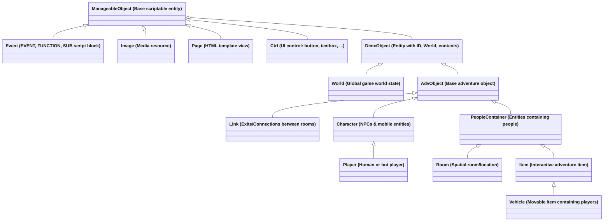
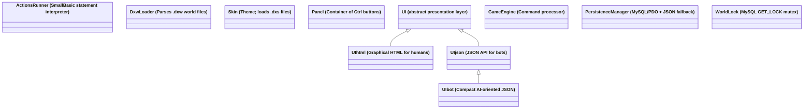
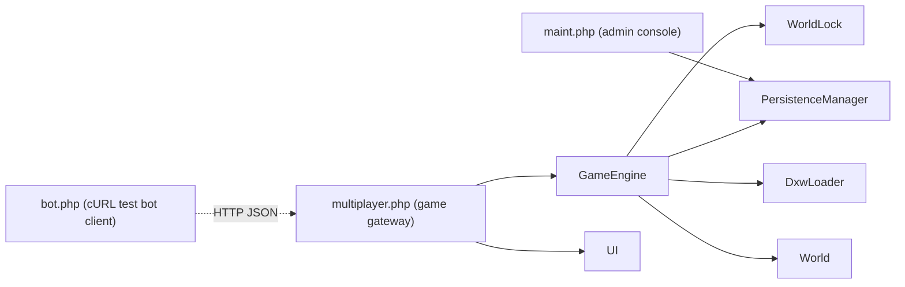
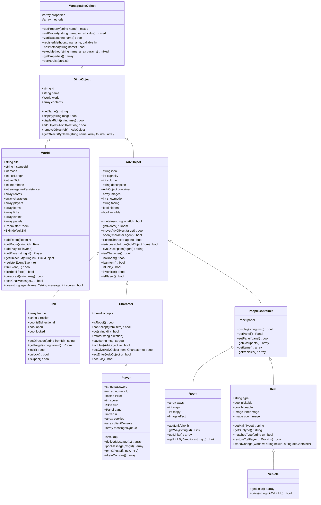
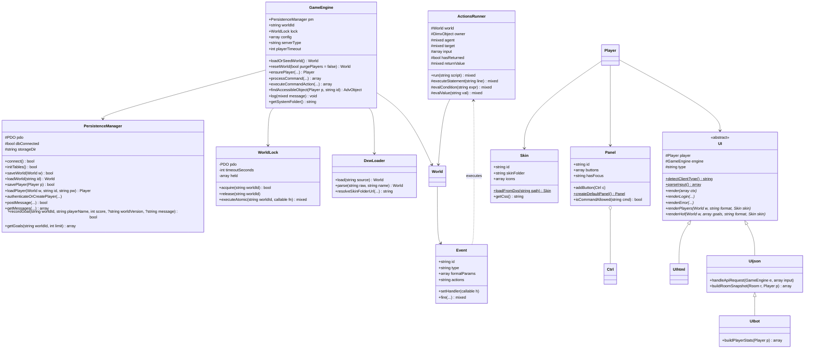

# Class Hierarchy of DimensioneY (`Dimx\` namespace, PHP)

> [!NOTE]
> **Project Summary**: This document describes the **DimensioneY** PHP implementation (`php/src/`, namespace `Dimx\`, PSR-4 autoloaded by [autoload.php](file:///c:/xampp/htdocs/dimya/php/autoload.php)). It is a port of the Java engine DimensioneX. For the original Java hierarchy, see [**DIMX_CLASS_HIERARCHY.md**](DIMX_CLASS_HIERARCHY.md). Both documents use the same structure so they can be compared section by section. There are **26 classes** (25 concrete + 1 abstract) across **26 source files**, plus 7 entry-point scripts.

---

## 1. High-Level Class Hierarchy Diagrams

### Core Game Domain Hierarchy (`ManageableObject`)
Same backbone as DimensioneX. [`ManageableObject`](file:///c:/xampp/htdocs/dimya/php/src/ManageableObject.php#L12) provides dynamic properties (`getProperty()`/`setProperty()`, magic `__get`/`__set`) and a registered-method table (`registerMethod()`, `execMethod()`) for SmallBasic scripting. `Dict`, `DictSorted`, `Token`, `DictEnumerator` are **gone**: they are replaced by native PHP `array` and loosely-typed `mixed` values.

> [!NOTE]
> Differences vs. DimensioneX: `Ctrl` now extends `ManageableObject` (it was a plain `Object` in Java), and `Dict`/`DictSorted` no longer exist.

---

### Script Execution, Loading, UI & Persistence Subsystems

The Java `DimxParser` hierarchy (`ActionsRunner`, `WorldLoader`, `SkinLoader`, `SmallBasicLoader`) and the `View*` hierarchy are re-organised: loaders are standalone classes, and views are replaced by a `UI` hierarchy selected per player type (human/bot).

---

### Entry-Point Scripts, Exceptions & Utilities

DimensioneX uses servlets (`multiplayer`, `Maint`) and dedicated exception/utility classes. DimensioneY uses plain PHP scripts under [`php/`](file:///c:/xampp/htdocs/dimya/php/) (not classes) and relies on native PHP exceptions, so `DimxException`, `NestedException`, `Const`, `Utils`, `Logger`, `Journal`, `Messages`, `Message`, `Client`, `Varspace` have no dedicated class.

---

## 2. Complete Class Catalog

All classes belong to namespace `Dimx`, located in [`php/src/`](file:///c:/xampp/htdocs/dimya/php/src/). "DimX equivalent" shows the Java counterpart in [DIMX_CLASS_HIERARCHY.md](DIMX_CLASS_HIERARCHY.md).

| Class | Superclass | DimX equivalent | Source File | Description / Architectural Role |
| :--- | :--- | :--- | :--- | :--- |
| [`ActionsRunner`](file:///c:/xampp/htdocs/dimya/php/src/ActionsRunner.php#L12) | — | `ActionsRunner` (+ part of `DimxParser`) | [ActionsRunner.php](file:///c:/xampp/htdocs/dimya/php/src/ActionsRunner.php) | Interprets SmallBasic event scripts line by line (`run()`, `executeStatement()`), with actions (`actOpen`, `actSpeak`, `actDisplay`, `actMove`, `actGoal`, ...), condition/expression evaluation and `$OWNER`/`$AGENT`/`$TARGET` resolution. No longer extends a parser: it does not inherit from `DimxParser` (which has no PHP counterpart). |
| [`AdvObject`](file:///c:/xampp/htdocs/dimya/php/src/AdvObject.php#L13) | [`DimxObject`](file:///c:/xampp/htdocs/dimya/php/src/DimxObject.php#L12) | `AdvObject` | [AdvObject.php](file:///c:/xampp/htdocs/dimya/php/src/AdvObject.php) | Base for in-world entities: `icon`, `capacity`, `volume`, `container`, `images`, `showmode`, `facing`, `hidden`, `invisible`, `showX/Y/For`. Provides `move()`, `open()`/`close()`, visibility/lock checks, `isAccessibleFrom()`, `evalDescription()` and type predicates (`isaRoom()`, `isanItem()`, `isLink()`, ...). |
| [`Character`](file:///c:/xampp/htdocs/dimya/php/src/Character.php#L13) | [`AdvObject`](file:///c:/xampp/htdocs/dimya/php/src/AdvObject.php#L13) | `Character` | [Character.php](file:///c:/xampp/htdocs/dimya/php/src/Character.php) | Actor/NPC with `accepts` rule. Implements movement (`go()`, `rotate()`, `actEnter()`, `actExit()`) and verbs (`actOpen`, `actClose`, `actUse`, `actUseWith`, `actSearch`, `actGive`), plus `say()` and direction helpers. |
| [`Ctrl`](file:///c:/xampp/htdocs/dimya/php/src/Ctrl.php#L12) | [`ManageableObject`](file:///c:/xampp/htdocs/dimya/php/src/ManageableObject.php#L12) | `Ctrl` | [Ctrl.php](file:///c:/xampp/htdocs/dimya/php/src/Ctrl.php) | UI control (`BUTTON`, `SUBMIT`, `TEXTBOX`, `DROPDOWN`, `LABEL`, `CR`, `MAP`, `CMD`) with caption, tooltip, event, image; renders itself via `toHtml()`. |
| [`DimxObject`](file:///c:/xampp/htdocs/dimya/php/src/DimxObject.php#L12) | [`ManageableObject`](file:///c:/xampp/htdocs/dimya/php/src/ManageableObject.php#L12) | `DimxObject` | [DimxObject.php](file:///c:/xampp/htdocs/dimya/php/src/DimxObject.php) | Common base of `World` and `AdvObject`: `id`, `name`, `world`, `contents` (array). Offers `display()`, `addObject()`, `removeObject()`, `getObjectsByName()`. |
| [`DxwLoader`](file:///c:/xampp/htdocs/dimya/php/src/DxwLoader.php#L12) | — | `WorldLoader` (+ `SmallBasicLoader`, part of `SkinLoader`) | [DxwLoader.php](file:///c:/xampp/htdocs/dimya/php/src/DxwLoader.php) | Fetches (local or URL) and parses `.dxw` files into a complete `World` graph (`load()`, `parse()`); selects `IMAGESFOLDER` / `IMAGESFOLDER_PUBLIC` / `IMAGESFOLDER_LOCAL` based on `serverType`, and resolves skin folders and image URLs. Embedded scripts become `Event` objects. |
| [`Event`](file:///c:/xampp/htdocs/dimya/php/src/Event.php#L13) | [`ManageableObject`](file:///c:/xampp/htdocs/dimya/php/src/ManageableObject.php#L12) | `Event` | [Event.php](file:///c:/xampp/htdocs/dimya/php/src/Event.php) | Script unit (`EVENT`, `FUNCTION`, `SUB`) with `formalParams` and `actions` source; `fire()` runs it (through a handler/`ActionsRunner`) and returns the result. |
| [`GameEngine`](file:///c:/xampp/htdocs/dimya/php/src/GameEngine.php#L13) | — | *(logic of `multiplayer` servlet)* | [GameEngine.php](file:///c:/xampp/htdocs/dimya/php/src/GameEngine.php) | Central processor decoupled from presentation (`serverType`, `config`): `loadOrSeedWorld()`, `resetWorld()`, `ensurePlayer()` (login/spawn), `processCommand()`, `executeCommandAction()` (all built-in verbs), `findAccessibleObject()`, `log()`. All mutations run inside `WorldLock::executeAtomic()`. |
| [`Image`](file:///c:/xampp/htdocs/dimya/php/src/Image.php#L11) | [`ManageableObject`](file:///c:/xampp/htdocs/dimya/php/src/ManageableObject.php#L12) | `Image` | [Image.php](file:///c:/xampp/htdocs/dimya/php/src/Image.php) | Media descriptor (`src`, `width`, `height`, `baseline`, `showarea*`); `toHtml()` renders ``, `toDXW()` serialises. |
| [`Item`](file:///c:/xampp/htdocs/dimya/php/src/Item.php#L12) | [`PeopleContainer`](file:///c:/xampp/htdocs/dimya/php/src/PeopleContainer.php#L12) | `Item` | [Item.php](file:///c:/xampp/htdocs/dimya/php/src/Item.php) | Interactive item with `type` (`main.subtype`), `pickable`, `hideable`, `innerImage`, `zoomImage`; `matchesType()`, `restoreTo()`, `worldChange()`. |
| [`Link`](file:///c:/xampp/htdocs/dimya/php/src/Link.php#L12) | [`AdvObject`](file:///c:/xampp/htdocs/dimya/php/src/AdvObject.php#L12) | `Link` | [Link.php](file:///c:/xampp/htdocs/dimya/php/src/Link.php) | Directional connection between rooms (`fromto`, `direction`, `isBidirectional`, `open`, `openable`, `locked`); `getTarget()`, `lock()`/`unlock()`, static opposite-direction helpers. |
| [`ManageableObject`](file:///c:/xampp/htdocs/dimya/php/src/ManageableObject.php#L12) | — | `ManageableObject` | [ManageableObject.php](file:///c:/xampp/htdocs/dimya/php/src/ManageableObject.php) | Root scriptable class: reflection-cached property metadata, dynamic `properties`, per-instance `methods` table, magic accessors, `__call()` dispatch. |
| [`Page`](file:///c:/xampp/htdocs/dimya/php/src/Page.php#L13) | [`ManageableObject`](file:///c:/xampp/htdocs/dimya/php/src/ManageableObject.php#L12) | `Page` | [Page.php](file:///c:/xampp/htdocs/dimya/php/src/Page.php) | HTML template with macro substitution in `toHtml()`. |
| [`Panel`](file:///c:/xampp/htdocs/dimya/php/src/Panel.php#L11) | — | `Panel` | [Panel.php](file:///c:/xampp/htdocs/dimya/php/src/Panel.php) | Ordered set of `Ctrl` buttons with focus; factories `createDefaultPanel()` / `createChatPanel()`, `getAvailableCommands()` and `isCommandAllowed()` for server-side command filtering. |
| [`PeopleContainer`](file:///c:/xampp/htdocs/dimya/php/src/PeopleContainer.php#L12) | [`AdvObject`](file:///c:/xampp/htdocs/dimya/php/src/AdvObject.php#L13) | `PeopleContainer` | [PeopleContainer.php](file:///c:/xampp/htdocs/dimya/php/src/PeopleContainer.php) | Container able to hold characters: `panel`, `display()` broadcast to occupants, `getOccupants()`, `getItems()`, `getVehicles()`. |
| [`PersistenceManager`](file:///c:/xampp/htdocs/dimya/php/src/PersistenceManager.php#L24) | — | *(part of `Cluster`, `Journal`)* | [PersistenceManager.php](file:///c:/xampp/htdocs/dimya/php/src/PersistenceManager.php) | PDO/MySQL repository with automatic JSON-file fallback: world and player save/load, authentication and account creation (bcrypt), settings, chat messages, table init/reset, diagnostics. |
| [`Player`](file:///c:/xampp/htdocs/dimya/php/src/Player.php#L13) | [`Character`](file:///c:/xampp/htdocs/dimya/php/src/Character.php#L13) | `Player` (+ `Client`) | [Player.php](file:///c:/xampp/htdocs/dimya/php/src/Player.php) | Human or bot session: credentials, `numericId`, `isBot`, `score`, `skin`, `panel`, screen metrics, `ui`, cookies, console buffer (`printXY`, `drainConsole`) and message queue (`deliverMessage`, `popMessage`). Absorbs the Java `Client` class. |
| [`Room`](file:///c:/xampp/htdocs/dimya/php/src/Room.php#L13) | [`PeopleContainer`](file:///c:/xampp/htdocs/dimya/php/src/PeopleContainer.php#L12) | `Room` | [Room.php](file:///c:/xampp/htdocs/dimya/php/src/Room.php) | Location with `ways` (exit links), map coordinates (`mapx`, `mapy`, `map`) and weather `effect` image. |
| [`Skin`](file:///c:/xampp/htdocs/dimya/php/src/Skin.php#L11) | — | `Skin` (+ `SkinLoader`) | [Skin.php](file:///c:/xampp/htdocs/dimya/php/src/Skin.php) | Theme (colors, styles, icons, pictures); `loadFromDxs()` parses `.dxs` skin files (see [SKINS.md](SKINS.md)); icon and CSS getters. |
| [`UI`](file:///c:/xampp/htdocs/dimya/php/src/UI.php#L14) | — (abstract) | `View` | [UI.php](file:///c:/xampp/htdocs/dimya/php/src/UI.php) | Abstract presentation layer bound to a `Player` and `GameEngine`; `detectClientType()` and `parseInput()` choose/parse human vs. bot requests. |
| [`UIbot`](file:///c:/xampp/htdocs/dimya/php/src/UIbot.php#L22) | [`UIjson`](file:///c:/xampp/htdocs/dimya/php/src/UIjson.php#L15) | — *(new)* | [UIbot.php](file:///c:/xampp/htdocs/dimya/php/src/UIbot.php) | AI-agent-oriented JSON variant with richer room, item, occupant, exit and stats snapshots. |
| [`UIhtml`](file:///c:/xampp/htdocs/dimya/php/src/UIhtml.php#L13) | [`UI`](file:///c:/xampp/htdocs/dimya/php/src/UI.php#L14) | `View` (+ `ViewDirect`) | [UIhtml.php](file:///c:/xampp/htdocs/dimya/php/src/UIhtml.php) | Full graphical HTML client for humans: login, error and game pages with `#scene` (`#display` + `#dashboard` with `#navpad`, items, inventory, stats), `#ctrls` (panels), `#msgs` (chat polling every `msgRefreshRate` seconds, default `5`s), viewport scaling `getFactorX()` with 1024px desktop width cap, and embedded client JavaScript. |
| [`UIjson`](file:///c:/xampp/htdocs/dimya/php/src/UIjson.php#L15) | [`UI`](file:///c:/xampp/htdocs/dimya/php/src/UI.php#L14) | — *(new)* | [UIjson.php](file:///c:/xampp/htdocs/dimya/php/src/UIjson.php) | REST/JSON API for bots: login/error/response payloads, room, item, occupant and exit snapshots, `handleApiRequest()`. |
| [`Vehicle`](file:///c:/xampp/htdocs/dimya/php/src/Vehicle.php#L12) | [`Item`](file:///c:/xampp/htdocs/dimya/php/src/Item.php#L12) | `Vehicle` | [Vehicle.php](file:///c:/xampp/htdocs/dimya/php/src/Vehicle.php) | Movable item carrying passengers; forwards room links to occupants (`getLinks()`) and `drive()`s. |
| [`World`](file:///c:/xampp/htdocs/dimya/php/src/World.php#L13) | [`DimxObject`](file:///c:/xampp/htdocs/dimya/php/src/DimxObject.php#L12) | `World` | [World.php](file:///c:/xampp/htdocs/dimya/php/src/World.php) | Aggregate root: indices of `rooms`, `characters`, `players`, `items`, `links`, `events`, `panels`, skins; settings (`mode`, `tickLength`, `interphone`, `savegamePersistence`, screen/scene sizes); `fireEvent()`, `tick()`, `broadcast()`, chat queue. |
| [`WorldLock`](file:///c:/xampp/htdocs/dimya/php/src/WorldLock.php#L31) | — | — *(new)* | [WorldLock.php](file:///c:/xampp/htdocs/dimya/php/src/WorldLock.php) | Per-world mutex over MySQL `GET_LOCK()`: `acquire()`, `release()`, `executeAtomic()`. Replaces Java servlet in-process synchronization. |

### Java classes with no PHP counterpart

| DimX class | Replaced by |
| :--- | :--- |
| `Dict`, `DictSorted`, `DictEnumerator` | Native PHP `array` (intentionally dropped) |
| `Token` | Native PHP loose typing / `mixed` |
| `Cluster`, `ViewCluster` | Intentionally dropped |
| `DimxParser`, `Varspace` | Logic folded into `ActionsRunner` / `DxwLoader` |
| `SkinLoader`, `SmallBasicLoader`, `WorldLoader` | `Skin::loadFromDxs()`, `DxwLoader` |
| `View`, `ViewDirect` | `UI` / `UIhtml` |
| `ViewAdmin`, `ViewHOF`, `ViewMap` | Partly `maint.php` (admin); `htmlAdminSnapshot()` methods on entities; HOF/Map views not implemented |
| `Client`, `Message`, `Messages` | `Player` fields; chat in `PersistenceManager`/`World`; no localisation layer |
| `Journal`, `Logger` | `World::$log` / `World::logDebug()` |
| `Const`, `Utils` | Class constants and inline helpers |
| `DimxException`, `NestedException` | Native PHP exceptions |
| `multiplayer`, `Maint` (servlets) | `multiplayer.php`, `maint.php` scripts + `GameEngine` |

---

## 3. Subsystem Breakdown & Architecture Patterns

### A. The Dynamic Entity & Scripting Model
- **Dynamic dispatch**: [`ManageableObject`](file:///c:/xampp/htdocs/dimya/php/src/ManageableObject.php#L12) keeps a `properties` bag and a `methods` table (`registerMethod()` / `execMethod()`), exposing class fields to scripts via `getProperty()` / `setProperty()` with cached reflection metadata.
- **Dynamic typing**: no `Token` wrapper. Scalars follow PHP coercion rules (`int`, `bool`, `string`, `float`); collections are PHP arrays.
- **Event model**: [`Event`](file:///c:/xampp/htdocs/dimya/php/src/Event.php#L13) objects are registered on [`World`](file:///c:/xampp/htdocs/dimya/php/src/World.php#L13) and fired with `fireEvent()`, passing `$OWNER`, `$AGENT`, `$TARGET`, `$WORLD` to [`ActionsRunner`](file:///c:/xampp/htdocs/dimya/php/src/ActionsRunner.php#L12).

### B. Spatial Containment Model (`PeopleContainer`)
Identical to DimensioneX:
- [`PeopleContainer`](file:///c:/xampp/htdocs/dimya/php/src/PeopleContainer.php#L12) sits between [`AdvObject`](file:///c:/xampp/htdocs/dimya/php/src/AdvObject.php#L13) and the containers.
- [`Room`](file:///c:/xampp/htdocs/dimya/php/src/Room.php#L13) and [`Item`](file:///c:/xampp/htdocs/dimya/php/src/Item.php#L12) extend it; [`Vehicle`](file:///c:/xampp/htdocs/dimya/php/src/Vehicle.php#L12) extends `Item`.
- Containment is expressed by `AdvObject::$container` and `DimxObject::$contents`.

### C. Execution Engine & World Loading
- [`DxwLoader`](file:///c:/xampp/htdocs/dimya/php/src/DxwLoader.php#L12) builds the `World` (rooms, links, items, characters, panels, skins, events).
- [`GameEngine`](file:///c:/xampp/htdocs/dimya/php/src/GameEngine.php#L13) loads (or seeds) the world through [`PersistenceManager`](file:///c:/xampp/htdocs/dimya/php/src/PersistenceManager.php#L24), dispatches each command, fires events and persists state, all under [`WorldLock`](file:///c:/xampp/htdocs/dimya/php/src/WorldLock.php#L31).

### D. Web Tier & Request Processing
- [`multiplayer.php`](file:///c:/xampp/htdocs/dimya/php/multiplayer.php) is the unified game gateway. `UI::detectClientType()` picks [`UIhtml`](file:///c:/xampp/htdocs/dimya/php/src/UIhtml.php#L13) (humans) or [`UIjson`](file:///c:/xampp/htdocs/dimya/php/src/UIjson.php#L15)/[`UIbot`](file:///c:/xampp/htdocs/dimya/php/src/UIbot.php#L22) (bots). The UI is stored in `Player::$ui`.
- Chat & message updates are polled via `multiplayer.php?view=msgs` every `msgRefreshRate` seconds (configured in [`php/config.php`](file:///c:/xampp/htdocs/dimya/php/config.php), default `5`s) to refresh `#msgs` and receive asynchronous client commands (`refresh!scene`, etc.).
- [`maint.php`](file:///c:/xampp/htdocs/dimya/php/maint.php) is the administration page (DB check/init, profiles, diagnostics); [`bot.php`](file:///c:/xampp/htdocs/dimya/php/bot.php) is a sample cURL bot client; [`test_multiplayer.php`](file:///c:/xampp/htdocs/dimya/php/test_multiplayer.php) holds automated tests.

#### Supported Gateway Views (`multiplayer.php?view=*`)
The `view` HTTP request parameter (via GET or POST) selects the response presentation:
- **`view=scene`** *(Default)*: Full interactive virtual world gameplay interface (`#scene`, `#display`, `#dashboard`, `#ctrls`, and `#msgs`).
- **`view=players`**: "Who's Online" view (§1.2.16). Displays the active player count; when called with `format=extended`, lists all connected players and their current room locations. Also supports `format=json`.
- **`view=hof`**: "Hall of Fame" view. Displays the name of the world, version, and the table of completed `Goal` events from `dimx_goals` in date order (latest to oldest), showing Date, Player Name, World Version, and Goal Message. Also supports `format=json`.
- **`view=msgs`**: Lightweight AJAX polling endpoint returning recent chat messages and queued client UI commands as JSON.

---

## 4. Detailed UML Class Diagrams with Operations & Attributes

### A. Core Domain Model Class Diagram

### B. Scripting, Loading, UI & Persistence Diagram

---

## 5. Additional Documentation Files in `docs/`
- [**DIMX_CLASS_HIERARCHY.md**](DIMX_CLASS_HIERARCHY.md) — Class hierarchy of the original DimensioneX (Java) project, for comparison.
- [**COMMANDS.md**](COMMANDS.md) — Game engine commands reference.
- [**SMALLBASIC.md**](SMALLBASIC.md) — SmallBasic language reference.
- [**SKINS.md**](SKINS.md) — Skins and `.dxs` specification.
- [**DXW_SPECIFICATION.md**](DXW_SPECIFICATION.md) — `.dxw` world file specification.
- [**uml_specifications.puml**](uml_specifications.puml) and [**uml_explorer.html**](uml_explorer.html) — PlantUML source and interactive explorer (they depict the original DimensioneX classes).
